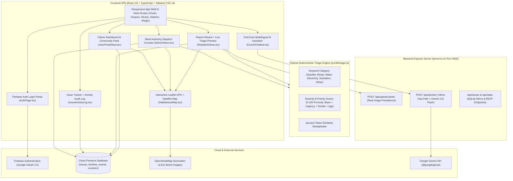
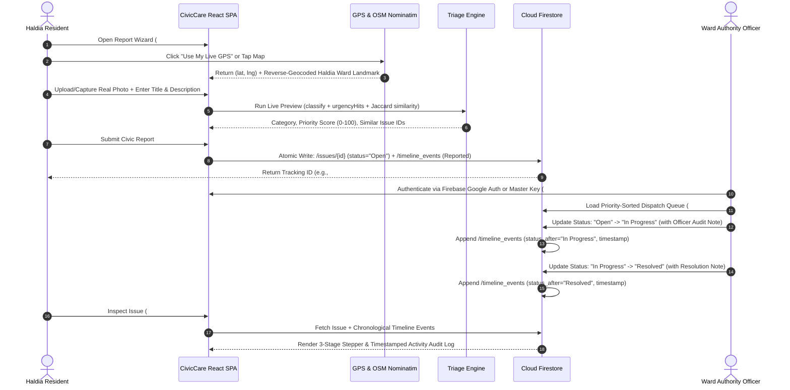
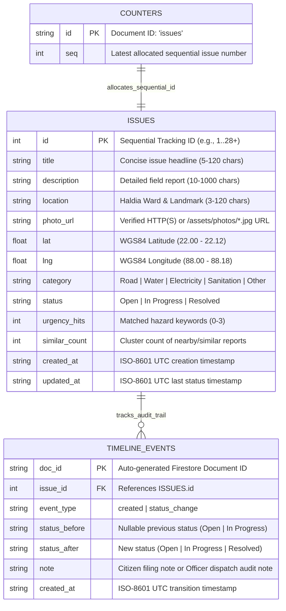

# CivicCare Haldia — Municipal Civic Issue Tracker & Real-Time Response Platform

**CivicCare Haldia** (`team-nova`) is a full-stack municipal civic issue reporting, automated priority triage, live geospatial tracking, and authority dispatch platform purpose-built for **Haldia Municipality**. It connects citizens and municipal ward officers through a unified real-time workspace backed by **Firebase Authentication**, **Cloud Firestore**, **Leaflet + OpenStreetMap Nominatim + Esri World Imagery**, and a sub-30ms **CivicCare AI Assistant**.

---

## Table of Contents

1. [Key Capabilities](#key-capabilities)
2. [System Architecture & Mermaid Diagrams](#system-architecture--mermaid-diagrams)
   - [High-Level System Architecture](#1-high-level-system-architecture)
   - [End-to-End Civic Issue Lifecycle & Audit Trail](#2-end-to-end-civic-issue-lifecycle--audit-trail)
   - [Cloud Firestore Data Model (ER Diagram)](#3-cloud-firestore-data-model-er-diagram)
3. [Project File Tree](#project-file-tree)
4. [Tech Stack](#tech-stack)
5. [How to Run Locally & in Production](#how-to-run-locally--in-production)
6. [Authentication & Authority Credentials](#authentication--authority-credentials)

---

## Key Capabilities

- **Dual-Portal Responsive Workspace**:
  - **Citizen / Resident Portal (`#/user`, `#/report`, `#/track`)**: Submit civic issues with real camera/gallery photos, pin exact GPS coordinates on an interactive street/satellite map, follow community issues, and inspect the timestamped status audit trail.
  - **Authority Admin Console (`#/admin`)**: Priority-ranked dispatch table ($0\text{–}100$ deterministic severity score), category & ward filters, status workflow transitions (`Open` $\rightarrow$ `In Progress` $\rightarrow$ `Resolved`) with mandatory audit notes, and benchmark accuracy validation ($\ge 85\%$).
  - **Firebase Authentication Entry Gate (`AuthPage.tsx`)**: Shown at the start of the site before entering the workspace; supports Google OAuth 2.0 sign-in for citizens and municipal officers, quick citizen entry, and Authority Master Key verification (`NOVA-HALDIA-KEY-2026`).
- **Timestamped Activity Log & Audit Trail**:
  - 3-stage visual milestone stepper (`Reported` $\rightarrow$ `In Progress` $\rightarrow$ `Resolved`) calculating exact turnaround durations (`+Xh Ym`) and total resolution SLA time, plus exportable chronological audit entries.
- **Real-Time Geospatial Map (`HaldiaIssueMap.tsx`)**:
  - Live HTML5 GPS tracking (`getCurrentPosition` + `watchPosition`), OpenStreetMap Nominatim address search & reverse geocoding, Esri World Imagery satellite layer toggle, and direct Google Maps verification links.
- **3-Tier Resilient Real Photo Engine (`CivicRealImage.tsx` & `/api/upload-photo`)**:
  - Multipart/base64 camera photo upload to `/public/assets/photos/`, verified Wikimedia Commons / Unsplash real photography per civic category, and an offline photographic canvas fallback so broken image icons never occur.
- **Ultra-Fast Multilingual CivicCare AI Chatbot (`CivicAiChatbot.tsx`)**:
  - Instant $<30\text{ms}$ deterministic responses for `#ID` issue lookups, ward analytics, and structured report drafting in **English, Bengali (বাংলা), and Hindi (हिन्दी)**, augmented by bounded Gemini (`gemini-3.8-flash`) assistance.

---

## System Architecture & Mermaid Diagrams

### 1. High-Level System Architecture



---

### 2. End-to-End Civic Issue Lifecycle & Audit Trail



---

### 3. Cloud Firestore Data Model (ER Diagram)



---

## Project File Tree

```text
/
├── README.md                          # Architecture, Mermaid diagrams, tech stack & setup guide
├── index.html                         # HTML5 entry point + Leaflet CSS & SEO metadata
├── metadata.json                      # AI Studio applet capability manifest
├── package.json                       # Dependencies & npm scripts (dev, build, start, lint)
├── tsconfig.json                      # TypeScript compiler configuration
├── vite.config.ts                     # Vite bundler & Tailwind CSS v4 plugin config
├── firebase-applet-config.json        # Provisioned Firebase project & Firestore DB configuration
├── firebase-blueprint.json            # Firestore schema blueprint for issues & timeline_events
├── firestore.rules                    # Production security rules (RBAC + schema validation)
├── server.ts                          # Express full-stack server (Photo upload, AI Chat, Vite middleware)
├── public/
│   └── assets/
│       └── photos/                    # User-uploaded real camera/gallery civic photos (*.jpg)
└── src/
    ├── main.tsx                       # React 19 DOM root mount
    ├── index.css                      # Tailwind CSS v4 import & custom map/scrollbar utilities
    ├── types.ts                       # Shared TypeScript interfaces (Issues, Timeline, Triage, Stats)
    ├── App.tsx                        # Responsive application shell, hash router & navigation bars
    ├── components/
    │   ├── AuthPage.tsx               # Dedicated Firebase Google Auth & Authority Key Login page (#/login)
    │   ├── UserPortalView.tsx         # Citizen Dashboard, KPIs, Community Feed & Followed Issues (#/user)
    │   ├── ResidentViews.tsx          # Report Issue Wizard (#/report), Success View & Track View (#/track)
    │   ├── AdminViews.tsx             # Authority Dispatch Console, Priority Queue & Drawer (#/admin)
    │   ├── IssueActivityLog.tsx       # 3-Stage Milestone Stepper & Timestamped Audit Trail Log
    │   ├── HaldiaIssueMap.tsx         # Interactive Leaflet Map (Live GPS, Nominatim Search, Satellite)
    │   ├── CivicRealImage.tsx         # 3-Tier resilient real photographic renderer
    │   ├── CivicAiChatbot.tsx         # Multilingual (<30ms) AI Civic Assistant drawer
    │   └── DemoWalkthroughDrawer.tsx  # Interactive 3-minute guided evaluation checklist
    └── lib/
        ├── firebase.ts                # Firebase Auth, Firestore CRUD, chunked batching & error handler
        ├── triage.ts                  # Deterministic classification, priority formula & benchmark suite
        ├── seed.ts                    # 28 realistic Haldia municipal seed issues with GPS coordinates
        └── syntheticAssets.ts         # Verified real photographs per civic category & URL healer
```

---

## Tech Stack

| Layer | Technology | Purpose |
| :--- | :--- | :--- |
| **Frontend Framework** | **React 19 + TypeScript** | Component architecture, hooks, and strict static typing |
| **Styling & Design** | **Tailwind CSS v4 (`@tailwindcss/vite`)** | Responsive mobile-first layout, civic slate palette, WCAG AA contrast |
| **Authentication** | **Firebase Authentication** | Google OAuth 2.0 (`signInWithPopup`) + Role/Master Key RBAC |
| **Primary Database** | **Cloud Firestore (Firebase JS SDK v12)** | Real-time persistent storage for `issues`, `timeline_events`, and `counters` |
| **Geospatial & Maps** | **Leaflet + OpenStreetMap Nominatim + Esri** | Interactive street & real satellite maps, live HTML5 GPS, reverse geocoding |
| **Backend Runtime** | **Node.js + Express + `tsx`** | Full-stack server on Port 3000 serving `/api/upload-photo` and `/api/ai/chat` |
| **AI & Triage Engine** | **Deterministic Triage + `@google/genai`** | Instant $<30\text{ms}$ local triage/lookup + bounded `gemini-3.8-flash` synthesis |
| **Icons** | **`lucide-react`** | Clean, accessible vector iconography |

---

## How to Run Locally & in Production

### Prerequisites
- **Node.js** $\ge 20.x$ and **npm** $\ge 10.x$

### 1. Install Dependencies
```bash
npm install
```

### 2. Configure Environment Variables (Optional for Local Override)
Create a `.env` file (or inspect `.env.example`):
```env
GEMINI_API_KEY="your_gemini_api_key_here"
ADMIN_TOKEN="NOVA-HALDIA-KEY-2026"
PORT=3000
```
*(Note: Firebase configuration is automatically loaded from `firebase-applet-config.json`. On first boot, the app automatically verifies and seeds the 28 Haldia municipal issues into Cloud Firestore if the collection is empty.)*

### 3. Start the Full-Stack Development Server
```bash
npm run dev
```
- Starts the Express + Vite middleware server on **`http://localhost:3000`**.

### 4. Type-Check & Build for Production
```bash
npm run lint
npm run build
npm start
```

---

## Authentication & Authority Credentials

- **Dedicated Login Route**: Navigate to **`#/login`** (or click **Sign In / Account** in the top bar, left sidebar, or mobile bottom bar).
- **Citizen Access**:
  - Sign in with any Google account via **Firebase Authentication**, or use the public citizen session to report and track issues immediately.
- **Ward Authority Access (`#/admin` & `#/login`)**:
  - **Provisioned Authority Master Key**:
    ```text
    NOVA-HALDIA-KEY-2026
    ```
  - **Firebase Google OAuth**: Sign in with an authorized Google account via the **Ward Authority Login** tab on `#/login` to unlock status transitions (`Open` $\rightarrow$ `In Progress` $\rightarrow$ `Resolved`) and audit logging.
