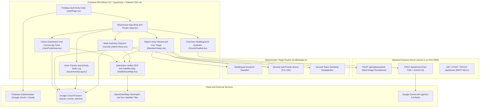
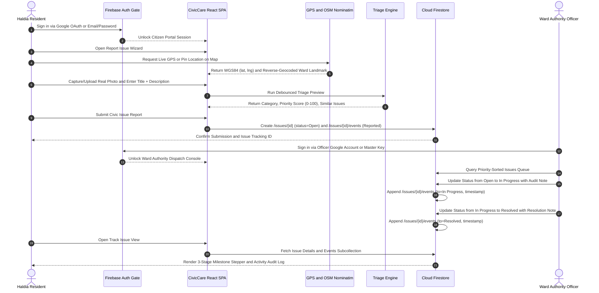
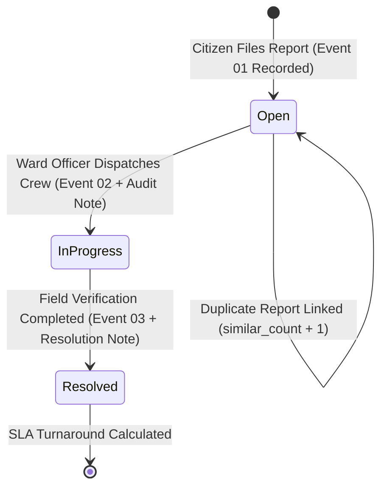
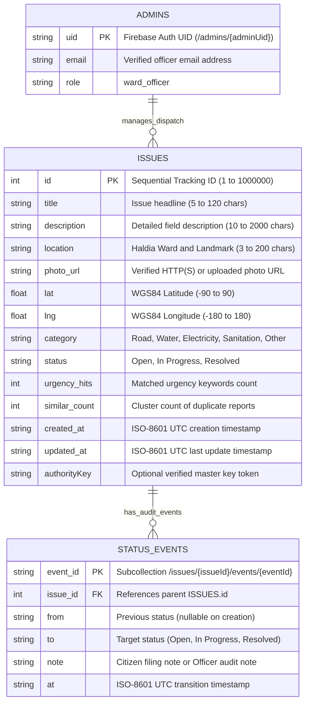

# CivicCare Haldia — Municipal Civic Issue Tracker & Real-Time Authority Dispatch Platform

**CivicCare Haldia** (`team-nova`) is an end-to-end municipal civic issue reporting, automated priority triage, live geospatial mapping, and authority dispatch platform purpose-built for **Haldia Municipality**. It connects citizens and municipal ward engineers through a unified real-time workspace backed by **Firebase Authentication**, **Google Cloud Firestore**, **Leaflet + OpenStreetMap Nominatim + Esri World Imagery**, and a sub-30ms **CivicCare AI Assistant**.

---

## Table of Contents

1. [Project Overview & Problem Statement](#project-overview--problem-statement)
2. [Key Capabilities](#key-capabilities)
3. [System Architecture & Mermaid Diagrams](#system-architecture--mermaid-diagrams)
   - [1. High-Level System Architecture](#1-high-level-system-architecture)
   - [2. End-to-End Civic Issue Lifecycle](#2-end-to-end-civic-issue-lifecycle)
   - [3. Issue Status State Machine & Audit Trail](#3-issue-status-state-machine--audit-trail)
   - [4. Cloud Firestore Data Model (ER Diagram)](#4-cloud-firestore-data-model-er-diagram)
4. [Automated Triage & Priority Scoring Engine](#automated-triage--priority-scoring-engine)
5. [Project File Tree](#project-file-tree)
6. [Tech Stack](#tech-stack)
7. [How to Run Locally & in Production](#how-to-run-locally--in-production)
8. [Authentication & Authority Credentials](#authentication--authority-credentials)

---

## Project Overview & Problem Statement

Urban and industrial municipalities like **Haldia** face recurring civic infrastructure challenges—waterlogged roads, burst pipelines, exposed high-voltage cables, uncollected solid waste, and non-functional streetlights. Traditional grievance systems suffer from four core bottlenecks:

1. **Delayed & Unstructured Reporting**: Citizens lack a fast, multilingual way to submit exact GPS coordinates and real field photos.
2. **Manual Triage Overload**: Municipal officers must manually read hundreds of complaints to determine which department (`Road`, `Water`, `Electricity`, `Sanitation`, `Other`) handles each issue.
3. **Duplicate Flooding & Lack of Prioritization**: Multiple residents report the same hazard (for example, a broken water main at Durga Chowk), cluttering the queue without surfacing life-safety emergencies first.
4. **Zero Public Accountability**: Once a complaint is filed, citizens rarely see when an issue moves from `Reported` to `In Progress` to `Resolved`, or how long each stage took.

**CivicCare Haldia** solves these problems by combining a 60-second GPS + Camera reporting wizard, a deterministic multilingual triage and deduplication engine, a priority-ranked municipal dispatch console, and a transparent timestamped activity audit log.

---

## Key Capabilities

- **Firebase Authentication Entry Gate (`AuthPage.tsx`)**:
  - Presented at the start of the site before entering the workspace.
  - **Citizen / Resident Login**: One-click **Firebase Google OAuth 2.0** (`signInWithPopup`) and **Firebase Email & Password** login to sync reported and followed issues across sessions.
  - **Ward Authority Login**: Verified Google Officer login or **Authority Master Key (`NOVA-HALDIA-KEY-2026`)** verification to unlock municipal dispatch operations.
- **Citizen Dashboard & Resident Portal**:
  - **Citizen Dashboard (`UserPortalView.tsx`)**: Real-time municipal KPIs (Total Issues, Open, In Progress, Resolved, Resolution Rate), a searchable **Community Civic Feed**, a **My Reported & Followed Issues** tracker, and a live **Ward Map**.
  - **Smart Report Wizard (`ResidentViews.tsx`)**: Debounced live triage preview, real camera/gallery photo upload, and HTML5 GPS + OpenStreetMap Nominatim reverse geocoding.
  - **Public Issue Tracker (`ResidentViews.tsx`)**: Instant lookup of any issue by tracking ID with full photographic, geospatial, and audit timeline visibility.
- **Timestamped Activity Log & Audit Trail (`IssueActivityLog.tsx`)**:
  - **3-Stage Lifecycle Milestone Stepper**: Tracks `1. Reported (Open)` → `2. In Progress` → `3. Resolved` with exact timestamps, relative time ago, elapsed turnaround duration (`+Xh Ym`), and **Total Resolution SLA** time.
  - **Exportable Chronological Audit Log**: Lists every status change (`01`, `02`, `03`) with transition badges, local time + UTC ISO-8601 timestamp, verified actor attribution (`Resident Portal Filing` vs. `Ward Authority Officer`), sort toggle, and one-click clipboard copy.
- **Real-Time Geospatial & Satellite Mapping (`HaldiaIssueMap.tsx`)**:
  - Live HTML5 GPS tracking (`getCurrentPosition` + `watchPosition`), OpenStreetMap Nominatim address search & reverse geocoding, **Street Map vs. Esri World Imagery Real Satellite** toggle, and direct Google Maps verification links.
- **3-Tier Resilient Real Photo Engine (`CivicRealImage.tsx` & `POST /api/upload-photo`)**:
  - Multipart/base64 camera photo upload to `/public/assets/photos/`, verified Wikimedia Commons / Unsplash real photography per civic category, and an offline photographic canvas fallback so broken image icons never occur.
- **Ultra-Fast Multilingual CivicCare AI Chatbot (`CivicAiChatbot.tsx`)**:
  - Sub-30ms deterministic responses for issue ID lookups, ward analytics, and structured report drafting in **English, Bengali (বাংলা), and Hindi (हिन्दी)**, augmented by bounded Google Gemini (`gemini-3.8-flash`) assistance.

---

## System Architecture & Mermaid Diagrams

### 1. High-Level System Architecture



---

### 2. End-to-End Civic Issue Lifecycle



---

### 3. Issue Status State Machine & Audit Trail



---

### 4. Cloud Firestore Data Model (ER Diagram)



---

## Automated Triage & Priority Scoring Engine

All triage rules are implemented deterministically in `src/lib/triage.ts` so both the client preview and authority queue produce identical, auditable results:

1. **Multilingual Category Classification**:
   - Evaluates weighted keyword matches across **English, Bengali, and Hindi** civic vocabularies for `Road`, `Water`, `Electricity`, `Sanitation`, and `Other`.
   - Validated against a 20-case benchmark suite achieving **≥ 85% classification accuracy**.
2. **Jaccard Duplicate Clustering**:
   - Tokenizes incoming reports and compares against active (`Open` / `In Progress`) issues in the same category/ward using Jaccard similarity (`threshold ≥ 0.28`).
3. **Priority Score Formula (`0–100`)**:
   ```text
   Priority = min(100, CategoryBase + (15 * min(3, UrgencyHits)) + (5 * min(4, SimilarCount)) + min(15, floor(AgeHours / 6)))
   ```
   - **Category Base Weights**: `Electricity` (35), `Water` (32), `Road` (28), `Sanitation` (25), `Other` (18).
   - **Urgency Boost**: `+15` per critical safety keyword (e.g., `live wire`, `sparking`, `hospital`, `school`, `flooding`, `sewage`), up to `+45`.
   - **Duplicate Cluster Boost**: `+5` per linked similar report, up to `+20`.
   - **Aging SLA Boost**: `+1` per 6 hours unresolved, up to `+15`.

---

## Project File Tree

```text
/
├── README.md                          # Project documentation, Mermaid diagrams, tech stack & setup guide
├── index.html                         # HTML5 entry point, Leaflet CSS & OpenGraph metadata
├── metadata.json                      # Application capability manifest
├── package.json                       # Dependencies & npm scripts (dev, build, start, lint)
├── tsconfig.json                      # TypeScript compiler configuration
├── vite.config.ts                     # Vite bundler & Tailwind CSS v4 plugin configuration
├── firebase-applet-config.json        # Provisioned Firebase project & Firestore DB configuration
├── firebase-blueprint.json            # Firestore schema blueprint for issues, events & admins
├── firestore.rules                    # Production Firestore security rules (RBAC + state machine)
├── server.ts                          # Express full-stack server (Photo upload, AI Chat, Vite middleware)
├── public/
│   └── assets/
│       └── photos/                    # User-uploaded real camera/gallery civic photos (*.jpg)
└── src/
    ├── main.tsx                       # React 19 DOM root mount
    ├── index.css                      # Tailwind CSS v4 import & map/layout utilities
    ├── types.ts                       # Shared TypeScript interfaces (Issues, Timeline, Triage, Stats)
    ├── App.tsx                        # Responsive application shell, entry gate & hash router
    ├── components/
    │   ├── AuthPage.tsx               # Initial Firebase Auth Entry Gate (Citizen & Authority login)
    │   ├── UserPortalView.tsx         # Citizen Dashboard, KPIs, Community Feed & Followed Issues (#/user)
    │   ├── ResidentViews.tsx          # Report Issue Wizard (#/report), Success View & Track View (#/track)
    │   ├── AdminViews.tsx             # Authority Dispatch Console, Priority Queue & Drawer (#/admin)
    │   ├── IssueActivityLog.tsx       # 3-Stage Milestone Stepper & Timestamped Audit Trail Log
    │   ├── HaldiaIssueMap.tsx         # Interactive Leaflet Map (Live GPS, Nominatim Search, Satellite)
    │   ├── CivicRealImage.tsx         # 3-Tier resilient real photographic renderer
    │   ├── CivicAiChatbot.tsx         # Multilingual (<30ms) AI Civic Assistant drawer
    │   └── DemoWalkthroughDrawer.tsx  # Interactive 3-minute guided evaluation checklist
    └── lib/
        ├── firebase.ts                # Firebase Auth, Firestore CRUD, chunked batching & error handler
        ├── triage.ts                  # Deterministic classification, priority formula & benchmark suite
        ├── seed.ts                    # 28 realistic Haldia municipal seed issues with GPS coordinates
        └── syntheticAssets.ts         # Verified real photographs per civic category & URL healer
```

---

## Tech Stack

| Layer | Technology | Purpose |
| :--- | :--- | :--- |
| **Frontend Framework** | **React 19 + TypeScript** | Modular functional components, hooks, and strict static typing |
| **Styling & Responsive UI** | **Tailwind CSS v4 (`@tailwindcss/vite`)** | Mobile-first responsive layout, civic slate palette, WCAG AA contrast |
| **Authentication** | **Firebase Authentication** | Google OAuth 2.0 (`signInWithPopup`), Email/Password, and Master Key RBAC |
| **Primary Database** | **Google Cloud Firestore (Firebase SDK v12)** | Real-time persistent storage for `issues`, `events` subcollections, and `admins` |
| **Geospatial & Maps** | **Leaflet + OpenStreetMap Nominatim + Esri** | Interactive street & real satellite maps, live HTML5 GPS, reverse geocoding |
| **Backend Runtime** | **Node.js + Express + `tsx`** | Full-stack server on Port 3000 serving `/api/upload-photo` and `/api/ai/chat` |
| **AI & Triage Engine** | **Deterministic Triage + `@google/genai`** | Instant `<30ms` local triage/lookup + bounded `gemini-3.8-flash` synthesis |
| **Icons** | **`lucide-react`** | Clean, accessible vector iconography |

---

## How to Run Locally & in Production

### Prerequisites
- **Node.js** ≥ 20.x
- **npm** ≥ 10.x

### 1. Clone & Install Dependencies
```bash
npm install
```

### 2. Configure Environment Variables (Optional Local Override)
Create a `.env` file in the project root:
```env
GEMINI_API_KEY="your_gemini_api_key_here"
ADMIN_TOKEN="NOVA-HALDIA-KEY-2026"
PORT=3000
```
*(Note: Firebase configuration is loaded automatically from `firebase-applet-config.json`. On first boot, the app automatically verifies and seeds the 28 Haldia municipal issues into Cloud Firestore if the collection is empty.)*

### 3. Start the Development Server
```bash
npm run dev
```
Open **`http://localhost:3000`** in your browser.

### 4. Type-Check & Build for Production
```bash
npm run lint
npm run build
npm start
```

---

## Authentication & Authority Credentials

When you launch **CivicCare Haldia**, the **Firebase Authentication Entry Gate** is displayed first:

1. **Citizen / Resident Access**:
   - Click **Sign In with Google (Firebase Auth)** or use the **Firebase Email & Password** form to enter the **Citizen Dashboard (`#/user`)**.
2. **Municipal Ward Authority Access**:
   - Switch to the **Ward Authority Login** tab at the entry gate.
   - Sign in with an authorized Google Officer account (`bappadityakuilya@gmail.com`) or enter the provisioned **Authority Master Key**:
     ```text
     NOVA-HALDIA-KEY-2026
     ```
   - Unlocks full dispatch privileges in `#/admin` to transition issues (`Open` → `In Progress` → `Resolved`) and record official audit trail notes.
