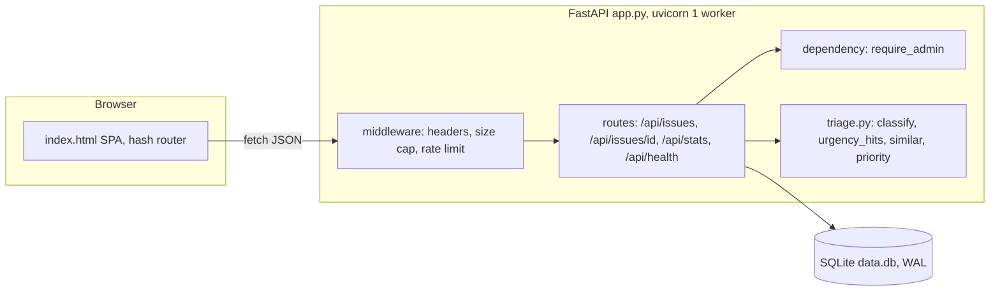
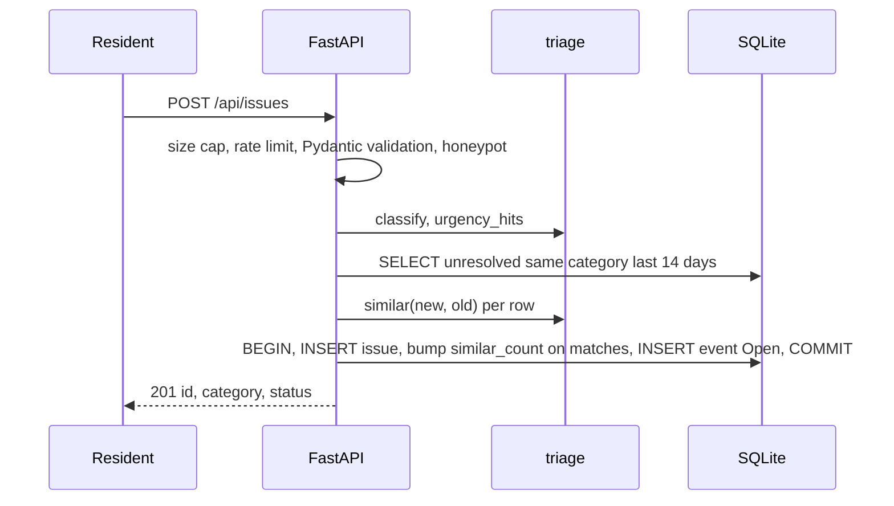
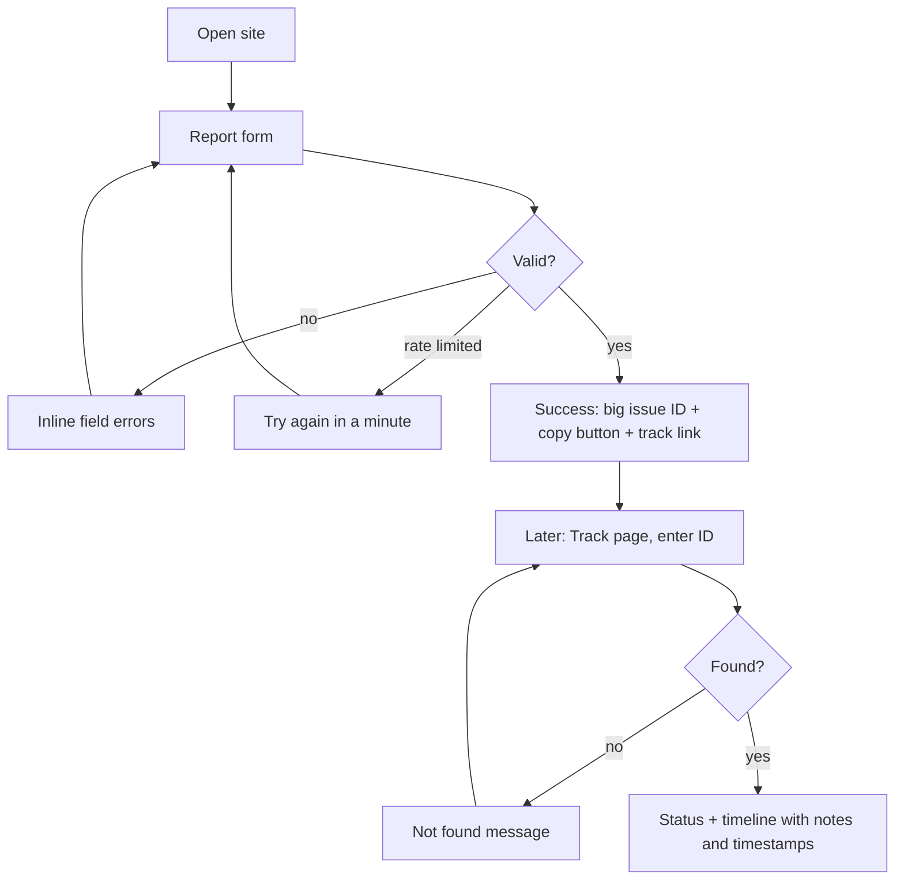
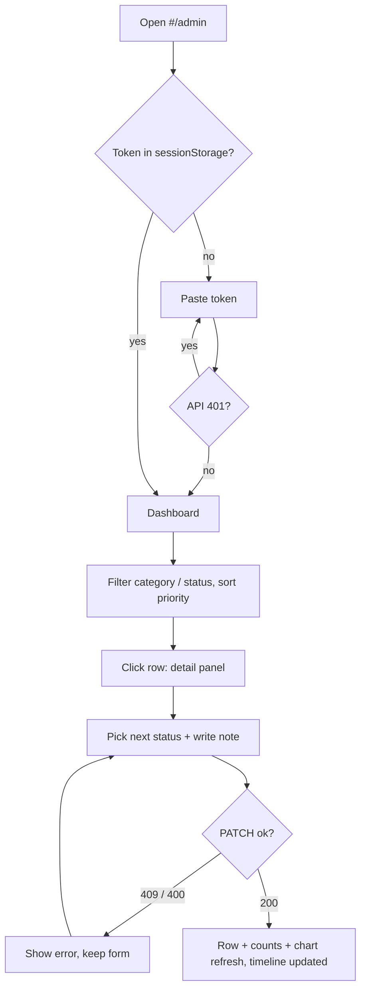
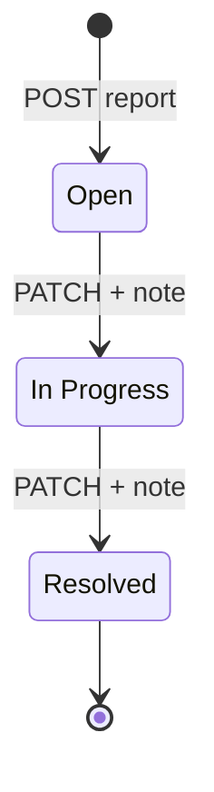

# PRD: Civic Issue Tracker (team-nova)

| Field | Value |
|---|---|
| Event | Hack Day Haldia x GRID community |
| Repo | `GRIDCOMMUNITY/team-nova` |
| Stack | **FastAPI** + SQLite + one-file vanilla frontend (stack is a team choice, not a rule) |
| Team | 3-4, all present |
| Budget | **5 hours hard** (README says 6, plan for 5) |
| Status | Draft v2, 2026-10-30 |

## 0. Read this first

**Ship all 7 core tasks, deployed, seeded, behind an admin token. Everything else is bonus.**

The starter is Flask. We replace `app.py` with FastAPI. Same repo, same routes, same `index.html` entry.

| Starter file | Action |
|---|---|
| `app.py` (Flask, 3 stubs returning 501) | Replace with FastAPI. Keep the same paths: `/api/health`, `/api/issues`, `/api/issues/{id}`, `/api/stats`. |
| `app.py` `debug=True` | Gone with Flask. Never run `--reload` in prod. |
| `requirements.txt` (`flask`, `gunicorn`) | `fastapi`, `uvicorn`. Pin versions. `httpx` as dev-only for tests. |
| `index.html` (pings `/api/health`) | Replace with SPA shell. Served by one route. |
| `README.md` ("Stack: Python / Flask") | Update stack line and run command. |
| `.gitignore` | Add `data.db`, `.env`. |
| tests | none. Add stdlib `unittest`. |

README rule "build on top of this starter project" is the one thing a strict organizer could read against a framework swap. Mitigation: keep the repo, history, routes and run command shape. Ask a mentor at kickoff (30 seconds). See risks 10.7.

---

## 1. PRD

### 1.1 Problem

Residents in Indian towns report broken roads, water leaks and power cuts through calls and WhatsApp forwards. Reports get lost, duplicated, never ranked. Authorities have no single list ordered by what is dangerous or overdue. Residents get no status, so they report again.

Cost of not solving: duplicate noise, urgent faults (live wire, burst main) buried under old low-risk complaints, zero accountability trail.

### 1.2 Users

| Persona | Needs | Auth |
|---|---|---|
| Resident | Report in under 60 seconds. Get an ID. Check progress later. | None. No account. No personal data collected. |
| Authority (ward officer / dispatcher) | See worst problems first. Filter. Change status with a note. | Shared admin token. |
| Judge | Open live link, see a populated system, run the flow in 3 minutes. | Demo token in submission text. |

### 1.3 User stories

| ID | Story |
|---|---|
| US1 | As a resident, I report an issue with title, description, location and optional photo link so authorities know what and where. |
| US2 | As a resident, I get an issue ID after submit so I can check later. |
| US3 | As a resident, I see clear field errors if my report is invalid so I fix it without guessing. |
| US4 | As a resident, I look up an ID and see a timeline of status changes with notes so I know someone acted. |
| US5 | As an authority user, I see issues sorted by priority so urgent ones surface first. |
| US6 | As an authority user, I filter by category and status so I handle my department's queue. |
| US7 | As an authority user, I move an issue Open -> In Progress -> Resolved with a note so residents see what happened. |
| US8 | As an authority user, I see counts and a chart by category and status so I read the load at a glance. |
| US9 | As an authority user, I cannot be impersonated by a stranger so the public cannot edit statuses. |

### 1.4 Requirements

**P0: cannot ship without. R1-R7 map 1:1 to README core tasks. R8, R9 are what the README forgot.**

| ID | Requirement | Acceptance (Given / When / Then) |
|---|---|---|
| R1 | Report form with validation | Given valid fields, when `POST /api/issues`, then 201 with `id`. Given title <5 or >120 chars, description <10 or >2000, location <3 or >200, photo_url not http(s) or >500, then 400 with per-field errors and no row written. |
| R2 | Auto-categorise to Road / Water / Electricity / Sanitation / Other | Given "pothole near school gate", then Road. Given no keyword hit or a tie, then Other. Accuracy >= 85% on the committed 40-item labelled set. |
| R3 | Priority score from urgent keywords, similar reports, age | Given two open issues of equal age, the one saying "live wire sparking" scores higher. Given 3 similar open reports vs 1, the cluster scores higher. Older age raises score, capped. Resolved scores 0. |
| R4 | Admin dashboard: filter category + status, sort by priority, counts, chart | Given token, dashboard loads sorted by priority desc, filters change the table without reload, counts and bar chart match `/api/stats`. |
| R5 | Status flow Open -> In Progress -> Resolved, timestamp + note on every change | Given Open, `PATCH In Progress` with note returns 200 and a timestamped event. Given Open, `PATCH Resolved` returns 409. Empty note (<3 chars) returns 400. Resolved is terminal. |
| R6 | Public lookup by ID with timeline | Given ID 12 exists, `#/issue/12` with no token shows title, description, category, status, timeline. Priority and similar count are **not** exposed. Unknown ID shows "not found", not a crash. |
| R7 | Persist in SQLite | Data survives process restart locally. On free hosts the file may reset: seed repopulates. |
| R8 | Admin auth | No or wrong token on list, PATCH, stats returns 401. `ADMIN_TOKEN` unset returns 503 (fail closed). |
| R9 | Deployed, seeded, live link works | First open of the live URL shows 25-30 seeded issues across all categories and statuses. |

**P1: only after R1-R9 pass on the live URL. Build in this order (value / cost):**

| ID | Requirement | Cost | Notes |
|---|---|---|---|
| R10 | Duplicate hint at submit: "similar report #N exists" | ~20 min | Reuses `similar()` from R3. |
| R11 | Notification preview on status change (email / SMS text shown, never sent) | ~30 min | Template strings in admin UI. No contact data stored. |
| R12 | Romanised Hindi / Bengali keywords (bijli, paani, jol, rasta, sadak, kachra, nali) | ~20 min | A native speaker on the team verifies the list. |
| R13 | Map view, Leaflet + OSM | ~45 min | Needs optional lat/lng at report. Columns already exist. Needs CSP change. |

**P2: design for it, do not build:** open-weight classifier behind `classify()`, reopen resolved issues, Bengali UI, staff assignment.

### 1.5 Success metrics

| Metric | Target | Measure | When |
|---|---|---|---|
| P0 checklist | 9 / 9 green on **live** URL | Manual run of acceptance table | T+3:30 |
| Classifier accuracy | >= 85% | `python -m unittest` on labelled set | T+2:45 |
| Report-to-dashboard latency | < 2 s | Manual, stopwatch | T+3:30 |
| Demo walkthrough | <= 3 min, no DB edits, no console errors | Rehearsal | T+4:45 |
| Judge opens link, sees data | 100%, including after host restart | Restart service, reload | T+4:15 |

### 1.6 Open questions

| # | Question | Owner | Blocking? | Default if unanswered |
|---|---|---|---|---|
| Q1 | Which host runs `uvicorn` | Team | **Yes**, decide by T+0:15 | Render free web service |
| Q2 | How do judges get the admin token | Team | **Yes** | Demo token in MLH submission text. Rotate after event. Accepted risk. |
| Q3 | Is a framework swap from the Flask starter acceptable | Mentor / organizers | No | Proceed. User decision: any stack allowed. |
| Q4 | Judging criteria on OrganizerHQ | Organizers | No | Assume working demo beats feature count |
| Q5 | Voyage PR repo link | Organizers | No, needed by T+4:30 | Ask at kickoff |

---

## 2. Architecture design

### 2.1 Shape

One FastAPI process. One SQLite file. One HTML file. No queue, no cache, no build step.



### 2.2 Files

| File | Job | Owner |
|---|---|---|
| `app.py` | Routes, Pydantic models, auth dependency, middleware, DB, lifespan (init + seed) | P1 |
| `triage.py` | Pure functions. No FastAPI, no DB. Unit-testable. | P2 |
| `seed.py` | Idempotent seed. Runs only if `issues` empty. Called from lifespan. | P2 |
| `index.html` | All UI, CSS and JS inline | P3 + P4 |
| `tests/test_triage.py` | Labelled set, priority, similarity | P2 |
| `tests/test_api.py` | POST, PATCH, 400 / 401 / 409 via `TestClient` | P1 |

`triage.py` is split out for one reason: two people write backend in parallel and need a stable seam. Everything else stays in `app.py` until it passes ~300 lines.

### 2.3 Request models (freeze at T+0:15)

Pydantic is the validation layer. No hand-written checks.

```python
class IssueIn(BaseModel):
    model_config = ConfigDict(str_strip_whitespace=True, extra="forbid")
    title: str = Field(min_length=5, max_length=120)
    description: str = Field(min_length=10, max_length=2000)
    location: str = Field(min_length=3, max_length=200)
    photo_url: str | None = Field(None, max_length=500, pattern=r"^https?://\S+$")
    lat: float | None = Field(None, ge=-90, le=90)
    lng: float | None = Field(None, ge=-180, le=180)
    website: str = ""            # honeypot, must stay empty

class StatusIn(BaseModel):
    model_config = ConfigDict(str_strip_whitespace=True, extra="forbid")
    status: Literal["In Progress", "Resolved"]
    note: str = Field(min_length=3, max_length=500)
```

FastAPI returns 422 by default. Override `RequestValidationError` to return **400** `{error, fields}` so the contract below holds and the frontend has one error shape.

### 2.4 Data model

Constraints live in the DB (CHECK), not only in Python. Second line of defence, costs nothing.

```sql
CREATE TABLE IF NOT EXISTS issues (
  id            INTEGER PRIMARY KEY AUTOINCREMENT,
  title         TEXT NOT NULL CHECK(length(title) BETWEEN 5 AND 120),
  description   TEXT NOT NULL CHECK(length(description) BETWEEN 10 AND 2000),
  location      TEXT NOT NULL CHECK(length(location) BETWEEN 3 AND 200),
  photo_url     TEXT CHECK(photo_url IS NULL OR length(photo_url) <= 500),
  lat           REAL,
  lng           REAL,
  category      TEXT NOT NULL CHECK(category IN ('Road','Water','Electricity','Sanitation','Other')),
  status        TEXT NOT NULL DEFAULT 'Open' CHECK(status IN ('Open','In Progress','Resolved')),
  urgency_hits  INTEGER NOT NULL DEFAULT 0,
  similar_count INTEGER NOT NULL DEFAULT 0,
  created_at    TEXT NOT NULL DEFAULT (strftime('%Y-%m-%dT%H:%M:%SZ','now')),
  updated_at    TEXT NOT NULL DEFAULT (strftime('%Y-%m-%dT%H:%M:%SZ','now'))
);
CREATE TABLE IF NOT EXISTS status_events (
  id          INTEGER PRIMARY KEY AUTOINCREMENT,
  issue_id    INTEGER NOT NULL REFERENCES issues(id),
  from_status TEXT,
  to_status   TEXT NOT NULL,
  note        TEXT NOT NULL CHECK(length(note) BETWEEN 3 AND 500),
  created_at  TEXT NOT NULL DEFAULT (strftime('%Y-%m-%dT%H:%M:%SZ','now'))
);
CREATE INDEX IF NOT EXISTS idx_issues_cat_status ON issues(category, status);
CREATE INDEX IF NOT EXISTS idx_events_issue ON status_events(issue_id);
```

Every report writes an initial event (`NULL -> Open`, note "Reported"). Timeline = that issue's events, oldest first.

Not stored: `priority`. It depends on age, so it is computed at read time. `# ponytail: compute in Python and sort in memory, fine under ~1k rows; move to SQL if it grows.`

Connection per request, `PRAGMA foreign_keys=ON`, `journal_mode=WAL`, `busy_timeout=5000`. Routes are plain `def` (not `async def`) so FastAPI runs the blocking `sqlite3` calls in its threadpool and never blocks the event loop.

### 2.5 API contract (freeze at T+0:15)

All errors: `{"error": "msg", "fields": {"name": "msg"}}`. `fields` only on 400.

| Method + path | Auth | Request | Success | Errors |
|---|---|---|---|---|
| `POST /api/issues` | public | `IssueIn` | 201 `{id, category, status}` | 400 fields, 413, 429 |
| `GET /api/issues` | admin | query: `category`, `status`, `sort=priority\|newest\|oldest` (default priority), `limit<=200` | 200 `{items:[{id,title,category,status,location,priority,band,similar_count,age_days,created_at}], total}` | 400, 401, 503 |
| `GET /api/issues/{id}` | public | none | 200 `{id,title,description,location,photo_url,category,status,created_at,updated_at,timeline:[{from,to,note,at}]}` | 404 |
| `PATCH /api/issues/{id}` | admin | `StatusIn` | 200 same shape as GET by id | 400, 401, 404, 409 `{error, allowed:[...]}` |
| `GET /api/stats` | admin | none | 200 `{total, by_category:{...}, by_status:{...}, high_open}` | 401, 503 |
| `GET /api/health` | public | none | 200 `{ok:true}` | none |
| `GET /` | public | none | `index.html` | none |

`category`, `status`, `sort` are typed as `Literal` query params: bad values get 400 from validation, never reach SQL.

With `ENABLE_DOCS=1` (local only), `/docs` renders this contract live from the models. Frontend people mock against it from minute 15.

### 2.6 `triage.py` contract (freeze at T+0:15)

| Function | Returns | Rule |
|---|---|---|
| `classify(title, description)` | `(category, confidence)` | Lowercase. Prefix word match so "potholes" hits "pothole". Title hits weigh x2. Highest total wins. Zero or tie -> `Other`. |
| `urgency_hits(title, description)` | `int` | Count of distinct urgent terms. |
| `similar(a, b)` | `bool` | Same category AND text Jaccard >= 0.30 AND at least 1 shared location token (len >= 3, stopwords removed). |
| `priority(row, now)` | `(score, band)` | Formula below. |

**Priority formula**

```
if status == Resolved: score = 0
else score = min(100, 30*min(urgency_hits,2) + 8*min(similar_count,5) + 2*min(age_days,10))
band: >=60 High, 30-59 Medium, <30 Low
```

Max components: 60 + 40 + 20. Urgency dominates, volume next, age breaks ties. Tune weights against seed data, not by feel.

**Keyword seeds (extend in 15 min with real reports)**

| Category | Terms (prefix match) |
|---|---|
| Road | pothole, road, highway, crack, footpath, pavement, speed breaker, bridge, culvert, asphalt, divider |
| Water | water, pipe, pipeline, leak, tap, tanker, supply, borewell, tubewell, contaminat, muddy |
| Electricity | electric, power, outage, blackout, transformer, wire, cable, pole, streetlight, street light, voltage, spark, meter |
| Sanitation | garbage, waste, trash, drain, sewage, sewer, manhole, toilet, dustbin, sanitation, stink, mosquito |
| Urgent | urgent, emergency, danger, accident, injur, spark, live wire, fire, flood, burst, collapse, open manhole, overflowing |

Known flaw: "waterlogged road" splits Water vs Road. Accept. Fix with the labelled set if accuracy < 85%.

### 2.7 Report pipeline



One transaction. If any step fails, nothing is written.

### 2.8 Runtime config

| Env var | Default | Notes |
|---|---|---|
| `ADMIN_TOKEN` | none | Required in prod. Unset -> admin routes 503. Min 16 chars. |
| `DB_PATH` | `data.db` next to `app.py` | Tests point it at a temp file. |
| `DEMO_SEED` | unset | `1` seeds on startup when `issues` is empty. |
| `ENABLE_DOCS` | unset | `1` turns on `/docs` and `/openapi.json`. Local only. |
| `PORT` | host sets it | Used in the start command. |

Run local: `ADMIN_TOKEN=dev-token-change-me DEMO_SEED=1 ENABLE_DOCS=1 uvicorn app:app --port 5000`

Run prod: `uvicorn app:app --host 0.0.0.0 --port $PORT --workers 1 --proxy-headers --forwarded-allow-ips='*'`

One worker on purpose: the in-memory rate limiter and SQLite writes both assume one process. `--forwarded-allow-ips='*'` is safe only because the host proxy is the sole route to the app.

---

## 3. Tech stack

The stack is a free choice. The 5-hour clock is the only constraint. Each pick below is the cheapest thing that works. Fancier options were considered and rejected for stated reasons.

| Layer | Pick | Why | Rejected |
|---|---|---|---|
| Backend | FastAPI, Python 3.11+ | Pydantic gives R1 validation with no hand-written checks. Typed contract. Optional live OpenAPI for frontend mocking. | Flask: manual validation, no contract. Django: setup cost. Node/Go: team already knows Python and `triage.py` is Python. |
| Server | uvicorn, 1 worker | Simplest ASGI server. | gunicorn + workers: breaks in-memory limiter, adds SQLite write contention. |
| DB | SQLite, stdlib `sqlite3`, WAL | Zero setup. CHECK constraints. Seed-on-boot hides the free-host reset. | Postgres on Neon / Supabase: survives restarts, but adds an account, a secret, a network failure mode, ~30+ min. Revisit only if everything else is done. |
| ORM | none | 2 tables, ~10 queries. | SQLAlchemy / SQLModel: setup and learning for no gain. |
| Validation | Pydantic v2 (ships with FastAPI) | Already installed. | Hand-rolled `if` chains. |
| Text matching | stdlib `re`, sets (Jaccard) | Stdlib does it. | scikit-learn, sentence-transformers: weight, install risk, cold start. |
| Frontend | One `index.html`, vanilla JS, hash router, `fetch` | No build step, no merge pain across node_modules. | React / Vite / Next / Svelte: a build pipeline costs ~1 hour of the 5. |
| Chart | Hand-rolled bars (CSS width % or inline SVG), ~25 lines | Zero dependency, offline-safe, no CSP change. | Chart.js: CDN risk during the demo. |
| Fonts | System stack: `system-ui`, `ui-monospace` | No network. | Google Fonts. |
| Tests | stdlib `unittest`. `fastapi.testclient.TestClient` for API (needs `httpx`, **dev only**). | Triage tests have zero deps. | pytest. |
| Deploy | Render free web service. Fallback: any host that runs `uvicorn` (Railway, Fly.io). | Plain process, env vars, Git deploy. | PythonAnywhere: WSGI-first, ASGI support is limited. Verify before choosing it. Docker: nothing to gain. |
| Map (P1) | Leaflet 1.9.4 + OSM tiles, CDN with SRI | README suggestion. | Mapbox / Google: API keys. |
| Model (P2) | Open-weight classifier behind `classify()` | Bonus only. The interface already allows the swap. | Training anything. |

New runtime dependencies for P0: `fastapi`, `uvicorn`. Nothing else.

---

## 4. Userflow

### 4.1 Resident



| Step | Screen state | Rule |
|---|---|---|
| 1 | Form: title, description, location, photo link (optional) | Submit disabled while request in flight. No double post. |
| 2 | Error | Errors under each field, form content preserved. |
| 3 | Success | ID shown large, monospace. Copy button. Link to track page. Tells user to save the ID: there is no account to recover it. |
| 4 | Track | ID input -> `#/issue/<id>`. |
| 5 | Timeline | Oldest to newest. Each entry: status, note, time. |

### 4.2 Authority



| Step | Rule |
|---|---|
| Login | Token stored in `sessionStorage` only. Sent as `X-Admin-Token`. Any 401 clears it and returns to login. |
| Dashboard | Loads sorted by priority desc. Top row is what to fix now. |
| Status change | UI offers only the single valid next status. Note required. Server still enforces. |
| Resolved | Terminal. Form hidden. Timeline still visible. |

---

## 5. Workflow

### 5.1 Issue lifecycle



| From | To | Allowed | Note |
|---|---|---|---|
| Open | In Progress | yes | required |
| In Progress | Resolved | yes | required |
| Open | Resolved | **no, 409** | Skipping hides work. To close fast, step through with two notes. |
| any | Open (back) | no | P2 reopen. Also blocked by `StatusIn` (`Literal` excludes Open). |
| Resolved | any | no | Terminal. |
| same -> same | no | 409 | |

### 5.2 Priority behaviour over time

| Event | Effect |
|---|---|
| New similar report arrives | Matching open issues get `similar_count + 1`. New issue starts with its own match count. Cluster rises together. |
| Day passes | Age term grows to its 10-day cap. |
| Status -> Resolved | Priority 0, drops off the top. |

### 5.3 Team build workflow

| Rule | Detail |
|---|---|
| Branches | `feat/<area>` per person. Rebase on `main` before PR. |
| Merge cadence | Small PRs to team `main`, at least every 45 min. No 3-hour branches. |
| Interface freeze | Models (2.3), API table (2.5), `triage.py` contract (2.6) frozen at T+0:15. Frontend mocks against them. Backend stubs return the shapes. |
| Review | One other person reads each PR for 5 minutes. Not a ceremony. |
| Commits | Imperative, short. Authors are team members. |
| Final PR | Open the PR on the assigned **Voyage repo** at T+4:30. Do not wait. |
| Always green | `main` always boots: `uvicorn app:app` starts, `/api/health` ok. Broken `main` is everyone's problem. |

### 5.4 Roles

| Person | Owns | Then |
|---|---|---|
| P1 Backend A | Models, POST, auth dependency, middleware (headers, limiter, size cap), `tests/test_api.py` | Deploy hardening |
| P2 Backend B | `triage.py`, labelled set, seed, `tests/test_triage.py`, GET list / PATCH / stats logic | R10, R12 |
| P3 Frontend A | Shell, router, report form, success, track page | R13 map |
| P4 Frontend B / Infra | Admin login, dashboard, chart, status form, **skeleton deploy at T+0:45**, PR, submission | R11 |

3 people: P4 role merges into P3 (frontend) and P1 (deploy + submission).

---

## 6. Appflow

Hash routing in one file. Server routes: `/` and `/api/*` only.

| Route | Screen | Auth | API calls | Empty / error state |
|---|---|---|---|---|
| `#/` | Report form (home) | none | `POST /api/issues` | Field errors inline. 429 banner. Network fail banner, form kept. |
| `#/done/<id>` | Success + ID | none | none | Bad ID -> redirect `#/` |
| `#/track` | ID lookup | none | none | Non-integer -> inline error |
| `#/issue/<id>` | Public detail + timeline | none | `GET /api/issues/{id}` | 404 -> "No issue with that ID". Loading state. |
| `#/admin` | Token gate -> dashboard | admin | `GET /api/stats`, `GET /api/issues?...` | 401 -> back to token gate. Empty filter -> "No issues match" + clear filters. |
| `#/admin/issue/<id>` | Detail panel + status form | admin | `GET /api/issues/{id}`, `PATCH /api/issues/{id}` | 409 shows allowed next status. Success re-fetches list + stats. |

**Dashboard layout (single screen, no scroll for the demo)**

| Zone | Content |
|---|---|
| Top strip | Total, Open, In Progress, Resolved, High-priority open. From `/api/stats`. |
| Left | Bar chart: issues per category, split by status. |
| Right | Filters (category, status, sort) over the table. |
| Table columns | ID (mono), priority score + band, title, category, status, age, similar count. Row click opens detail. Detail shows score parts: urgency / similar / age. |

**Client state:** three variables: `token`, `filters`, `route`. No framework. Re-render a view = replace its container's children. All user text inserted via `textContent`.

**Request rules:** every `fetch` has a catch. Every non-2xx parses `{error, fields}`. One `api()` helper adds the token header and handles 401 centrally.

---

## 7. Goals

| # | Goal | Measure |
|---|---|---|
| G1 | All 7 README core tasks work end to end on the live URL | R1-R7 acceptance, 7/7 |
| G2 | Triage is visibly correct: urgent items outrank old trivial ones | Top 5 of the seeded dashboard are the genuinely dangerous ones. Classifier >= 85% on 40 labelled items. |
| G3 | Demo cannot look empty or dead | Seed 25-30 issues, mixed ages and statuses, 3 duplicate clusters |
| G4 | Status trail is trustworthy | Every status row has a timestamp and note. No transition is skippable. |
| G5 | Admin is not open to the world | Unauthenticated PATCH returns 401 in a live curl test |
| G6 | Submission lands on time | PR opened and MLH submitted by T+4:45. 15 min spare. |

## 8. Non-goals

| Non-goal | Why |
|---|---|
| Resident accounts, login, email verification | No value in 5 hours. ID-based lookup is enough. |
| Collecting phone / email / name | Zero PII means zero PII liability. R11 preview uses sample text, stores nothing. |
| Sending real email / SMS | Needs keys, vendors, abuse handling. Preview only. |
| Photo upload and storage | URL only. Storage + scanning is its own project. |
| Training a model | Keywords first. Open model is P2 behind the same function. |
| Edit or delete issues | Audit trail stays intact. |
| Reopen, reassign, comment threads | P2. Strict 3-state flow is the spec. |
| Multi-city, multi-tenant, roles beyond admin | One token, one deployment. |
| Real-time push (websockets) | Refresh is fine. |
| Pagination infra, caching, queues | `limit<=200`. Demo scale. |
| Frontend framework, build pipeline | One HTML file. Build step cost beats any gain. |
| Native mobile app | Responsive page covers phones. |
| Docker, CI pipeline | Nobody grades it. |
| Design system | One direction, one hour total (see 10.6). |

---

## 9. Security

Data held is low-sensitivity (public civic reports, no PII). The threat is **abuse and takeover**, not secrets. Controls scale to that.

| # | Threat | Control | Where | Verify |
|---|---|---|---|---|
| S1 | Stored XSS via title / description / location | Render all user text with `textContent` / `createElement`. Never `innerHTML` with user data. CSP `default-src 'self'`; `script-src 'self' 'unsafe-inline'` because JS is inline (accepted trade-off: textContent discipline is the real defence). | `index.html`, middleware | Submit `` in all fields: renders as text on public and admin pages. |
| S2 | SQL injection | Parameterised queries only. `sort`, `category`, `status` are `Literal` query params, then whitelist dicts. | `app.py` | Title `'; DROP TABLE issues;--` and `category=x' OR 1=1`: no effect, second returns 400. |
| S3 | Unauthenticated status change | `require_admin` dependency on every admin route. `ADMIN_TOKEN` env, `hmac.compare_digest`, fail closed (503 if unset). Token in header, not cookie, so no CSRF. | `app.py` | `curl -X PATCH .../api/issues/1` returns 401. |
| S4 | Token brute force | 5 failed auth / min / IP then 429. Token >= 16 random chars. Never logged, never in URL. | `app.py` | Script 10 bad tokens: 429. |
| S5 | Report spam | 5 POST / min / IP, honeypot `website` (non-empty -> fake 201, no write), Pydantic length caps, `extra="forbid"`, `Content-Length` cap 16 KB in middleware (missing or larger -> 413). `# ponytail: in-memory limiter, per process, lock-guarded. Fine with 1 worker; move to Redis if scaled.` | `app.py` | Loop 10 POSTs: 429 after 5. 20 KB body: 413. |
| S6 | `photo_url` abuse (`javascript:`, `data:`, tracker pixel, SSRF) | Pydantic pattern allows `http` / `https` only. Server **never fetches** it. UI shows a plain link: `rel="noopener noreferrer nofollow" target="_blank"`, not an ``, so an attacker URL cannot log the admin's IP on page load. | `app.py`, `index.html` | `javascript:alert(1)` returns 400. |
| S7 | Exposed docs, auto-reload | `FastAPI(docs_url=None, redoc_url=None, openapi_url=None)` unless `ENABLE_DOCS=1`. Never `--reload` in prod. Swagger UI also loads scripts from a CDN, which the CSP would block. | `app.py`, start command | Prod `GET /docs` returns 404. |
| S8 | ID enumeration | IDs sequential. Accepted: reports are public by nature and hold no PII. Public view hides priority and similar count so rankings cannot be gamed. | `GET /api/issues/{id}` | Public response has no `priority` key. |
| S9 | Priority gaming (stuff "urgent" into text) | Urgency capped at 2 hits = 60 pts. Spam is rate limited. Admin eyeballs top rows. Accepted residual risk. | `triage.py` | Unit test: 10 urgent words still gives max 60 urgency points. |
| S10 | Clickjacking, sniffing, referrer leaks | `X-Frame-Options: DENY`, `X-Content-Type-Options: nosniff`, `Referrer-Policy: no-referrer` from one middleware. | `app.py` | `curl -I` shows headers. |
| S11 | Error leakage | Handlers: `RequestValidationError` -> 400 `{error, fields}`, `HTTPException` -> `{error}`, generic `Exception` -> 500 `{"error":"server error"}`. No stack traces. | `app.py` | Force an exception: body is `{"error":"server error"}`. |
| S12 | SQLite locks under threads | One worker, WAL, `busy_timeout=5000`, `foreign_keys=ON`, writes in one transaction, connection per request. | `db()` | 20 parallel POSTs: all 201 or 429, none 500. |
| S13 | Secrets in git | `.env`, `data.db` in `.gitignore`. Token only in host env UI. | repo | `git log -p` grep for token: none. |
| S14 | Dependency risk | `fastapi`, `uvicorn` only. Pinned. `httpx` dev only, not in prod install. | `requirements.txt` | n/a |
| S15 | Demo token exposure | Token appears in submission text for judges. Accepted. Rotate after event. Seed data is fake. | Process | Rotate at T+5:00. |

Out of scope: WAF, TLS config (host provides), audit logging, GDPR tooling, pen test.

---

## 10. Additional

### 10.1 Timeline (5:00, T = start)

| T+ | Block | Exit criteria |
|---|---|---|
| 0:00-0:15 | Kickoff: read PRD, freeze 2.3 / 2.5 / 2.6, assign roles, branches, pick host, ask mentor about the framework swap | Everyone knows their file. Q1, Q2 answered. |
| 0:15-0:45 | Schema + lifespan `init_db`. `triage.py` stubs. FastAPI routes return contract-shaped stubs. HTML shell + router. Draft 40-item labelled set. | `uvicorn app:app` boots, `/api/health` ok |
| **0:45** | **Deploy skeleton to host.** Set `ADMIN_TOKEN`. | Live URL returns `/api/health`. Finds host problems while there is time. |
| 0:45-1:45 | POST + models + classify + urgency. Report form + success page. `similar()` + `priority()`. | R1, R2 pass locally |
| 1:45-2:45 | GET list + filters + sort. PATCH + transitions. `/api/stats`. Admin login + table. | R3, R5 pass locally |
| 2:45-3:30 | Chart, public track page, seed, integration, security checks S1-S7 | R4, R6, R7, R8, R9 pass **on live URL** |
| **3:30** | **Feature freeze for P0.** Run full acceptance table live. | 9 / 9, or fix only P0 until green |
| 3:30-4:15 | P1 in order R10, R11, R12, R13. Stop at 4:15 regardless. | Each P1 merges only if it breaks nothing |
| 4:15-4:30 | Code freeze. Restart host, confirm seed repopulates and cold start works. | Live link works after restart |
| 4:30-4:45 | PR to Voyage repo. MLH / OrganizerHQ submission. Demo token in text. | Submitted |
| 4:45-5:00 | Demo rehearsal x2. Buffer. | 3 min, no errors |

### 10.2 Cut order when behind

P0 is never cut. P1 cuts first, in this order: R13 map, R11 notification preview, R12 romanised keywords, R10 duplicate hint. If P0 itself slips at T+3:30: drop chart polish (keep counts), drop stat tiles, keep everything in R1-R9 functional.

### 10.3 Seed data (`seed.py`)

| Item | Spec |
|---|---|
| Count | 28 issues |
| Spread | 6 Road, 6 Water, 6 Electricity, 6 Sanitation, 4 Other |
| Status | 16 Open, 7 In Progress, 5 Resolved (with real events and notes) |
| Age | `created_at` backdated 0-20 days |
| Clusters | 3 groups of 3-4 near-duplicates (burst pipe, dead streetlights, garbage pile) so similarity visibly lifts priority |
| Urgent | 4 issues with danger terms (live wire, open manhole, burst main, tree on wire) |
| Locations | Haldia-area locality names as free text (Durgachak, Hatiberia, Basudevpur, Bhabanipur). Team verifies spelling. All reports fictional. |
| Rule | Idempotent: skip if `issues` has rows. Runs in lifespan startup when `DEMO_SEED=1`. |

### 10.4 Demo script (3 min)

| Sec | Action | Shows |
|---|---|---|
| 0:00 | Open live URL at phone width | Responsive, no login for residents |
| 0:20 | Submit "live wire sparking near school gate", Haldia locality | Validation passes, ID returned |
| 0:50 | `#/admin`, paste token | Auth gate |
| 1:00 | New issue is **top row**, Electricity, High band | R2, R3 |
| 1:20 | Submit second near-duplicate report | `similar_count` bumps, score rises |
| 1:50 | Set In Progress with note, then Resolved with note | R5, notes, timestamps |
| 2:20 | Open public `#/issue/<id>` in private window | R6, no priority leaked |
| 2:40 | Point at counts + chart changing | R4 |
| 2:50 | `curl -X PATCH` with no token: 401 | S3 |

### 10.5 Test plan (stdlib `unittest`)

| Test | Count | Covers |
|---|---|---|
| Classifier labelled set | 40 items, includes 8 Other and 6 hard ties | R2, accuracy >= 85% |
| Urgency cap | 2 | S9 |
| `similar()` pairs | 10 labelled pairs (5 dup, 5 not) | R3 |
| `priority()` | 5 (resolved=0, caps, bands) | R3 |
| API: POST valid / each invalid field | 8 | R1 |
| API: PATCH legal, skip, same, empty note, unknown id | 5 | R5 |
| API: no token / wrong token / unset env | 3 | R8, S3 |
| API: public GET has no `priority` | 1 | R6, S8 |

Run: `python -m unittest discover tests`. Target under 5 seconds. API tests use `TestClient` and a temp `DB_PATH`.

### 10.6 UI direction (one choice, held everywhere)

Municipal notice board. Dense, flat, legible. Not a SaaS landing page.

| Token | Value |
|---|---|
| Paper | `#f4f1ea` |
| Ink | `#111111` |
| Signal (High priority, errors) | `#d9480f` |
| OK (Resolved) | `#2b8a3e` |
| Mid (In Progress) | `#1c64a8` |
| Type | `system-ui` for text, `ui-monospace` for IDs and scores |
| Shape | 1px ink borders, 0-2px radius, no shadows, no gradients |
| Motion | None, except instant state changes |
| Layout | Table-first admin. Single-column form for residents. No hero, no card grid. |
| Copy | Plain verbs. "Report a problem", "Check an issue". No exclamation marks. |
| A11y | Real `<label>`s, visible focus ring, color never the only signal (band text beside color), contrast >= 4.5:1 |

### 10.7 Risks

| Risk | Likelihood | Hit | Mitigation |
|---|---|---|---|
| Free host wipes SQLite on restart | **Certain** | Empty dashboard in front of judges | Seed on startup (R9). Force a restart at T+4:15 and check. |
| Free host cold start (service sleeps when idle) | High | First judge load takes tens of seconds | Open the live URL 2 minutes before demo. Put a note in the submission text. |
| Deploy discovered broken at the end | High if deployed last | Fatal | Skeleton deploy at T+0:45. |
| Organizer reads "build on top of the starter" strictly | Low-Medium | Disqualification risk | Same repo, history, routes, `index.html` entry, run-command shape. Ask a mentor at kickoff. Q3. |
| Frontend blocked on backend | High | Idle people | Frozen models and contract at T+0:15. Stub routes return real shapes. |
| Bonus work before core works | High (everyone loves the map) | P0 incomplete | Hard gate: P1 starts only after live acceptance 9/9. |
| Keyword classifier looks dumb on a judge's input | Medium | Credibility | Confidence + `Other` fallback. Extend keywords from seed text. R12. |
| Priority looks arbitrary | Medium | Weak story | Show score parts (urgency / similar / age) in the admin detail panel. Cheap, convincing. |
| Host chosen cannot run ASGI | Low | Lost time | Q1 by T+0:15, verified by the T+0:45 skeleton deploy. |
| One person ill or absent | Low | Rule: every member present | Roles collapse per 5.4. |
| Merge conflicts in one `index.html` | **High** | Lost time | Split by route into marked `<script>` regions. P3 owns top half, P4 bottom half. Rebase often. |
| Judges cannot access admin | Medium | Cannot see dashboard | Q2: token in submission text. |

### 10.8 Brutal truths

1. A working boring thing beats a half-working impressive thing. Judges click the link.
2. The README lists 7 core tasks and no auth. An open admin PATCH is the first thing a sharp judge tries. R8 is P0.
3. Empty dashboard = dead project. Seed data is a P0 deliverable, not polish.
4. Free stack freedom is a trap. Every new tool is setup time you do not have. FastAPI earns its place because it deletes validation code. A frontend framework or Postgres would not.
5. "Auto-categorise" with keywords is fine. Claiming AI you did not build is not. Say "keyword triage" in the pitch. Name the open-model path as next step.
6. Priority needs a visible explanation or it reads as random numbers.
7. The map is the most tempting trap. It is bonus #1 in the README and last in our order, on purpose.
8. If the live link breaks during judging, nothing else counts. Freeze at 4:15 and mean it.

### 10.9 Definition of done

| Check | Pass |
|---|---|
| R1-R9 acceptance table, run on the live URL | 9 / 9 |
| `python -m unittest discover tests` | green |
| Security table S1-S7, S10 verify column | all done |
| Host restart | data reseeds, site works |
| PR opened on Voyage repo | link saved |
| MLH / OrganizerHQ submission | confirmation seen |
| Demo run twice, <= 3 min | yes |
| Token rotated after event | scheduled |

### 10.10 Submission checklist (from README)

| Item | Owner | Done |
|---|---|---|
| All core tasks work end to end | All | [ ] |
| Project deployed, live link opens | P4 | [ ] |
| PR on the Voyage GitHub repo assigned to team | P4 | [ ] |
| Submitted on MLH platform (OrganizerHQ) | P4 | [ ] |
| 3-4 members present | All | [ ] |
